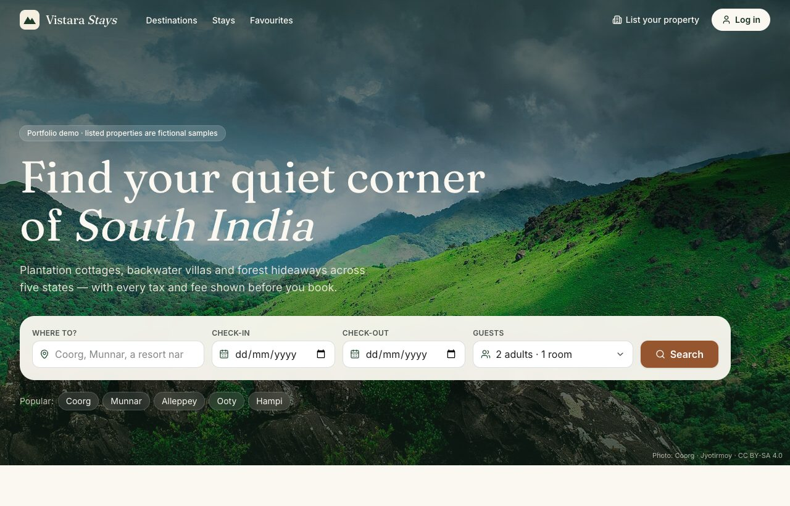
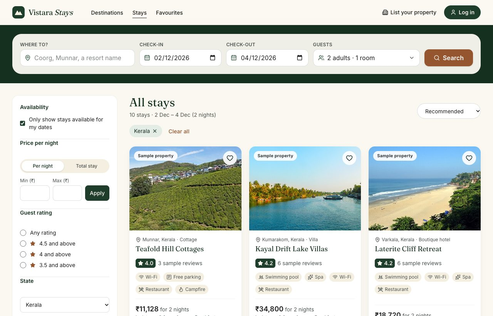
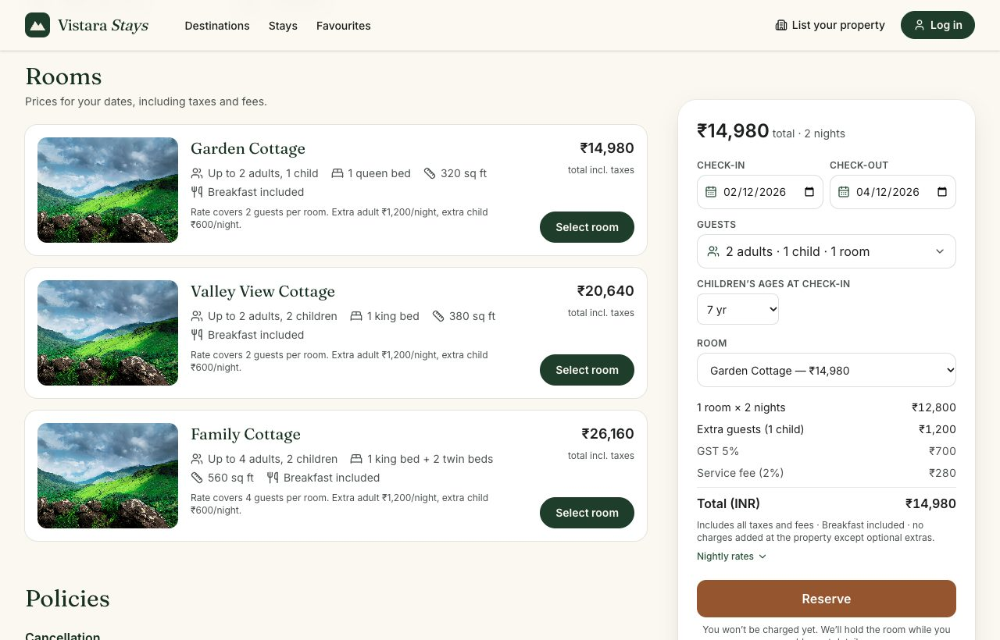
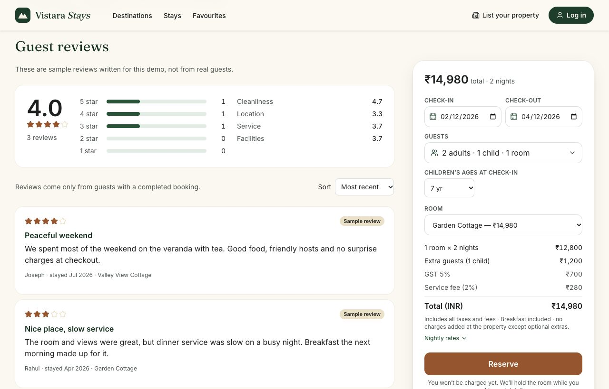
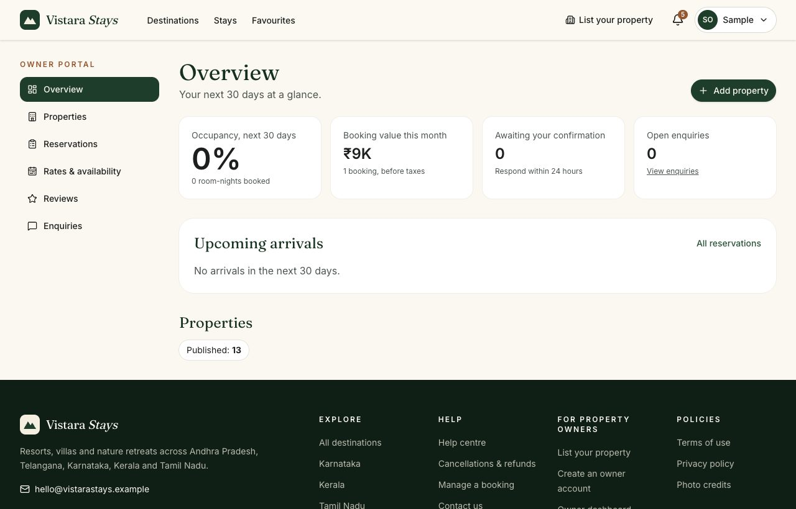
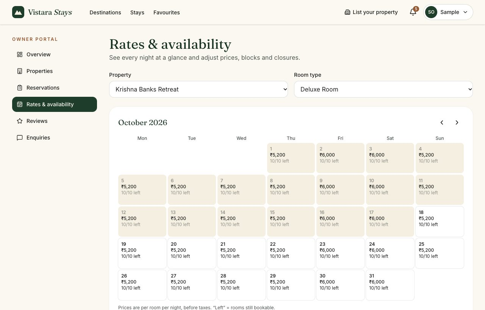
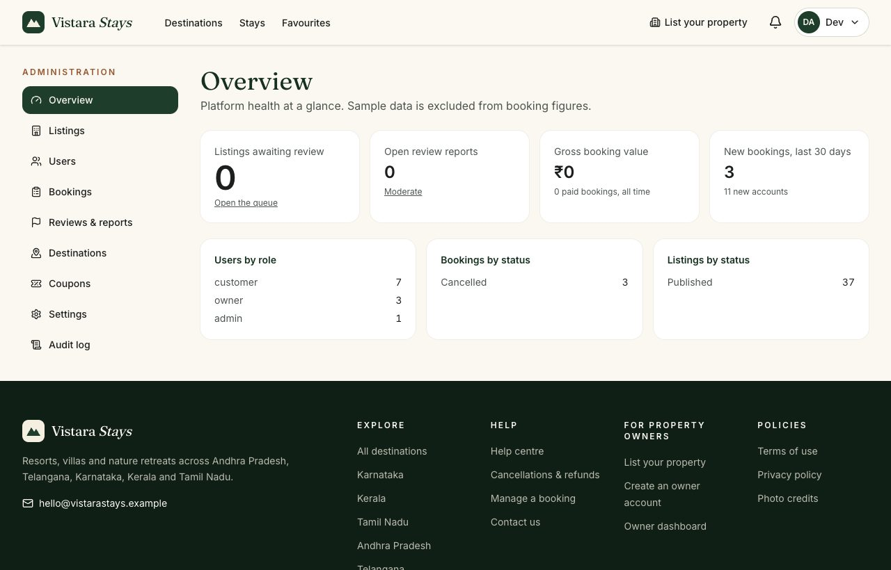
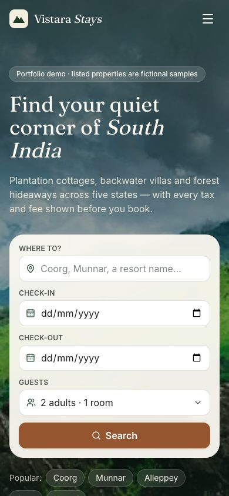
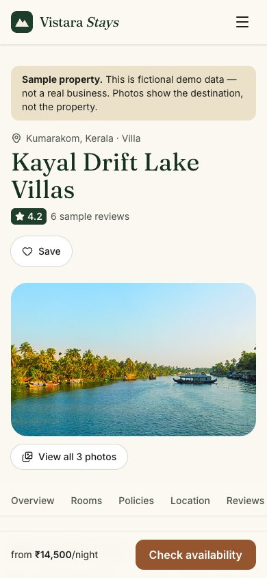

# Vistara Stays

**A full-stack resort booking platform for South India** — search and book resorts, villas and
homestays across 25 destinations, with separate portals for property owners and administrators.

FastAPI · MongoDB (Atlas) · React 19 + Vite · Tailwind CSS · TanStack Query · Razorpay (test mode)

> **Portfolio project.** Every resort, owner, guest and review in the seed data is fictional and
> labelled as a sample in the UI. Destination photos are real, credited Creative Commons images.



## Highlights

- **No double bookings, even under concurrency.** Each room type has one inventory counter per night
  (unique index). A booking reserves every night with a conditional atomic update *and* inserts the
  booking inside one MongoDB transaction — all nights or none. A test fires 20 simultaneous bookings
  at the last room: exactly one succeeds (with the guard removed, 11 oversell — the test is
  mutation-checked). → [booking engine design](docs/06-booking-engine.md)
- **Prices only from the server.** Weekday/weekend rates, seasonal rules, date overrides, extra
  guests, per-night GST slabs, coupons and service fee — computed in integer paise with explicit
  rounding, and snapshotted onto each booking together with its cancellation policy.
- **Holds, idempotency and payments done properly.** 15-minute holds that expire lazily (no cron
  needed on a sleeping free-tier server), `Idempotency-Key` on booking creation, Razorpay signature
  verification on checkout callbacks and webhooks, refunds shown as refunded only after the provider
  confirms.
- **Security by default.** Argon2id, short-lived JWTs in memory + rotating httpOnly refresh cookies
  with reuse detection, server-side role checks on every route, owner isolation enforced in every
  query, CSRF/CSP/security headers, rate limits, content-sniffed uploads, audit log.
- **Tested end to end.** 222 backend tests (92% coverage, real MongoDB replica set), 79 frontend
  tests, and 9 browser journeys run against the production build with a strict CSP.
- **Accessible.** Lighthouse accessibility 100, keyboard-navigable, visible focus, screen-reader
  labels, no layout shift.

## Screenshots

| Search with live prices | Resort page — rooms & itemised price |
|---|---|
|  |  |
| **Reviews with rating breakdown** | **Owner dashboard** |
|  |  |
| **Owner rates & availability calendar** | **Admin overview** |
|  |  |

<p align="center"> </p>

## Features

**Guests (no account needed to browse)** — destinations by state and type · search by place, town or
resort name with dates and guests · filters (price per night or total stay, rating, type, category,
amenities, surroundings, distance) · sorting and URL-shareable results · resort pages with gallery,
rooms, live availability, itemised prices, policies, map, nearby attractions, reviews, enquiries.

**Customers** — sign-up with email verification · password reset · favourites · booking with
lead-guest details (18+, no ID numbers collected online) · coupons · hold countdown · simulated or
Razorpay payment · trips, cancellations with refund preview · reviews after completed stays ·
notifications · account deletion (anonymised).

**Owners** — onboarding and listing editor (details, location, amenities, policies, photos, rooms) ·
submission for review · dashboard (occupancy, booking value, pending actions) · rates & availability
calendar (special prices, blocks that never override bookings, closures, seasonal rules) ·
reservations with privacy-limited guest contact · confirm/decline requests · replies to reviews ·
enquiries.

**Admins** — listing approval queue (approve / request changes / suspend) · users (suspending signs
them out everywhere) · bookings (full-refund cancellations) · review moderation and reports ·
destinations and categories as data · coupons · platform settings (GST slabs, fees, limits) ·
audit log.

## Architecture

```
React SPA (Vercel) ──/api/* rewrite──▶ FastAPI (Render) ──▶ MongoDB Atlas (replica set, transactions)
                                             ├──▶ Cloudinary (images)   ├──▶ Razorpay (payments)
                                             └──▶ Resend (email)
```

The backend is layered: **routes** (HTTP only) → **services** (business rules: pricing, availability,
booking state machine, ownership) → **repositories** (database access). Domain errors map to one
consistent JSON error shape. → [Architecture](docs/02-architecture.md) ·
[Data model](docs/04-data-model.md) · [API reference (98 endpoints)](docs/10-api-reference.md)

```
backend/   app/{api/routes, core, db, models, schemas, services, repositories, utils} · scripts/ · tests/
frontend/  src/{api, components, features, layouts, pages, routes, hooks, utils} · vercel.json
e2e/       Puppeteer browser journeys + screenshot generator
docs/      requirements → architecture → data model → API → booking engine → testing → deployment
```

## Run it locally (macOS)

Prerequisites: Python 3.12, Node 22, a MongoDB Atlas cluster (free tier is fine), and `mongod` for tests.

```bash
# Backend
cd backend
python3.12 -m venv .venv && source .venv/bin/activate
pip install -r requirements-dev.txt
cp .env.example .env            # set MONGODB_URI and JWT_SECRET (instructions inside)
python -m scripts.seed           # 25 destinations, 37 fictional resorts, sample reviews
uvicorn app.main:app --reload    # API docs at http://127.0.0.1:8000/api/docs

# Frontend (new terminal)
cd frontend && npm install && npm run dev    # http://localhost:5173
```

Sample logins (password `Vistara#Demo2026`): `demo.customer@example.com`,
`owner.westernghats@example.com`. Create an admin with `python -m scripts.create_admin --email …`.
Details: [local setup guide](docs/08-local-setup.md).

## Tests

```bash
cd backend && ./scripts/test_mongo.sh start && pytest --cov=app   # 222 tests, real replica set
cd frontend && npm run lint && npm test                            # 79 tests
cd e2e && npm install && ADMIN_PASSWORD=… npm test                 # 9 browser journeys (dev servers running)
```

What the tests prove, the manual checklist and the security checklist:
[Testing & security](docs/09-testing-and-security.md).

## Deploy

GitHub → MongoDB Atlas → Render (`render.yaml`) → Vercel (`frontend/vercel.json`), with CI in
`.github/workflows/ci.yml`. Step by step: [deployment guide](docs/11-deployment.md).

## Documentation

1. [Requirements & scope](docs/01-requirements.md)
2. [Architecture](docs/02-architecture.md)
3. [User journeys & screens](docs/03-user-journeys.md)
4. [MongoDB data model](docs/04-data-model.md)
5. [REST API design](docs/05-api-spec.md)
6. [Booking, pricing & availability engine](docs/06-booking-engine.md)
7. [Roadmap & phase exit criteria](docs/07-roadmap.md)
8. [Local setup (macOS)](docs/08-local-setup.md)
9. [Testing & security](docs/09-testing-and-security.md)
10. [API reference (generated)](docs/10-api-reference.md)
11. [Deployment](docs/11-deployment.md)

## Limitations

Single-instance rate limiting and email outbox (Redis needed to scale out) · date-aware search prices
candidates in application code (fine at this scale) · one room type per booking · GST rates must be
verified by a tax professional before real use · live Razorpay/Cloudinary/Resend need your own
accounts (their code paths are tested against fakes). Full list in
[docs/09](docs/09-testing-and-security.md#4-known-limitations-honest-list).

## Credits

Destination photographs from [Wikimedia Commons](https://commons.wikimedia.org), used under their
Creative Commons licences — photographer and licence for each are listed on the site's
`/credits` page. Maps © [OpenStreetMap](https://www.openstreetmap.org/copyright) contributors.
Icons by [Lucide](https://lucide.dev). Fonts: Fraunces and Inter (SIL Open Font License).
